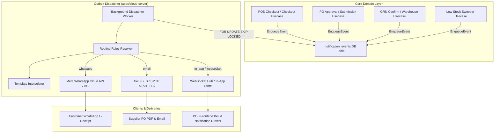

# Nembus Notification Center & Transactional Outbox Engine

The **Nembus Notification Engine** provides an enterprise-grade, transactional event-driven notification infrastructure across cloud and offline-capable edge POS terminals.

---

## 🏗️ Architectural Overview

---

## 📡 Supported Channels & Deliveries

### 1. Customer WhatsApp Digital Receipts (`whatsapp`)
- **API**: Direct Meta WhatsApp Cloud API (`https://graph.facebook.com/v19.0/{phone_number_id}/messages`).
- **Authentication**: System User Permanent Access Token with `whatsapp_business_messaging`.
- **Payloads**:
  - Interactive template messages (approved Meta templates).
  - Freeform text receipt with e-invoice link and ZATCA Phase 2 QR verification.
  - Document attachments (e.g. PDF receipts).
- **Trigger**: Checkout on POS or online order completion when customer phone/WhatsApp is provided.

### 2. Supplier & Procurement Management Email (`email`)
- **Transport**: AWS Simple Email Service (SES) or custom SMTP server using STARTTLS encryption on Port 587 / 465.
- **Payloads**:
  - HTML transactional emails with company branding.
  - Base64 MIME multipart attachments (formal Purchase Order PDFs).
- **Triggers**:
  - `po.submitted`: Sent to procurement manager for review.
  - `po.approved`: Automatically dispatched to the supplier's primary contact email.
  - `po.rejected`: Sent back to the requisition creator with rejection notes.

### 3. Internal Real-Time Alerts & In-App Bell (`websocket` / `in_app`)
- **Transport**: Persistent WebSocket connections at `/api/ws/notifications`.
  - Authenticated via `?token=<jwt>&tenant_id=<slug>` or `Authorization: Bearer <jwt>`.
  - Multi-tenant and role-targeted routing (e.g. Store Managers, Inventory Staff).
- **In-App Store**: Persisted in `notification_in_app` table with read status and actions URLs.
- **Frontend UI**:
  - Dynamic pill badge count (`unreadCount$`).
  - Interactive slide-down inbox drawer with severity icons (`critical`, `warning`, `success`, `info`).
  - Instant desktop banners via `ngx-toastr`.
- **Triggers**:
  - `grn.posted`: Warehouse receipt alerts.
  - `inventory.low_stock`: Automatic sweep of items below `reorder_level`.
  - PO approval actions.

---

## 🗄️ Database Schema & Canonical Source of Truth

The canonical schema is maintained in `packages/core/db/schema/88_notifications.sql`:

1. `notification_channels`: Multi-tenant channel credentials (encrypted JSON config).
2. `notification_templates`: Multi-lingual mustache/Go text templates with variable interpolation (`{{.CustomerName}}`, `{{.TotalAmount}}`, etc.).
3. `notification_routing_rules`: Mappings between event types, target audiences (`customer`, `supplier`, `role`, `fixed`), and delivery channels.
4. `notification_events`: Transactional outbox table (`status IN ('pending', 'processing', 'completed', 'failed')`) with retry counters.
5. `notification_deliveries`: Audit trail of each delivery attempt, external message IDs, and HTTP response errors.
6. `notification_in_app`: Bell inbox store for authenticated users.

---

## 🔌 API Endpoints & Swagger Reference

All endpoints are registered under `/api/notifications` in `packages/core/routing/notifications.go`:

| Method | Endpoint | Description | Swagger Model |
|:---|:---|:---|:---|
| `GET` | `/api/notifications` | Paginated in-app notifications for authenticated user | `NotificationListResponse` |
| `GET` | `/api/notifications/unread-count` | Unread notifications count for bell badge | `UnreadCountResponse` |
| `POST` | `/api/notifications/:id/read` | Mark individual notification as read | `NotificationInAppItem` |
| `POST` | `/api/notifications/read-all` | Mark all user notifications as read | `SuccessResponse` |
| `GET` | `/api/notifications/channels` | List all channel configurations | `ChannelsListResponse` |
| `GET` | `/api/notifications/channels/:type` | Get channel configuration credentials | `NotificationChannelItem` |
| `PUT` | `/api/notifications/channels/:type` | Update channel credentials (Meta / SES) | `NotificationChannelItem` |
| `GET` | `/api/notifications/templates` | List notification templates | `TemplatesListResponse` |
| `POST` | `/api/notifications/templates` | Create or update notification template | `NotificationTemplateItem` |
| `DELETE` | `/api/notifications/templates/:id` | Delete notification template | `SuccessResponse` |
| `GET` | `/api/notifications/rules` | List event routing rules | `RulesListResponse` |
| `POST` | `/api/notifications/rules` | Create routing rule | `NotificationRoutingRuleItem` |
| `PUT` | `/api/notifications/rules/:id` | Update routing rule | `NotificationRoutingRuleItem` |
| `DELETE` | `/api/notifications/rules/:id` | Delete routing rule | `SuccessResponse` |
| `GET` | `/api/ws/notifications` | Live WebSocket stream for real-time dispatch | `WebSocket Stream` |

---

## 💻 Frontend Configuration & UI

Administrators can manage Meta WhatsApp and AWS SES settings directly in the Backoffice / POS Client:
1. Navigate to **Settings** > **Notification Channels**.
2. Configure **Meta WhatsApp Cloud API**:
   - Toggle **Active**
   - **Phone Number ID** (from Meta App Dashboard)
   - **WABA ID** (WhatsApp Business Account ID)
   - **System User Permanent Access Token**
3. Configure **AWS SES & SMTP Email**:
   - Toggle **Active**
   - **From Email Address** & **Sender Name**
   - **SMTP Host**, **Port** (e.g. 587), **Username**, and **Password**
4. Click **Save Settings** to persist directly to the database.
